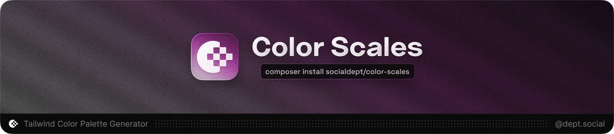

[](https://github.com/socialdept/color-scales)

<h3 align="center">
    Generate Tailwind-compatible color palettes from any input color.
</h3>

<p align="center">
    <br>
    <a href="https://packagist.org/packages/socialdept/color-scales" title="Latest Version on Packagist"></a>
    <a href="https://packagist.org/packages/socialdept/color-scales" title="Total Downloads"></a>
    <a href="https://github.com/socialdept/color-scales/actions/workflows/tests.yml" title="GitHub Tests Action Status"></a>
    <a href="LICENSE" title="Software License"></a>
</p>

---

This package turns a single color into an 11-shade palette, from 50 to 950, in the shape Tailwind CSS uses. It works out where the input color belongs in the scale, builds the other shades around it in HSLuv or HSL following the [tints.dev](https://tints.dev) algorithm, and exports the result as hex, RGB, HSL, OKLCH or a Tailwind v3 or v4 config. To learn all about it, head over to [the documentation](https://socialde.pt/docs/color-scales).

Here are a few short examples of what you can do.

Generate a palette from a hex color:

```php
use SocialDept\ColorScales\ColorScale;

$palette = ColorScale::generate('#d8b965');

$palette->toHex();
// [50 => '#fcf3e1', 100 => '#f9e6c0', 200 => '#f1ce71', 300 => '#d8b965', ...]
```

Start from RGB, HSL or OKLCH instead:

```php
$palette = ColorScale::generate('oklch(0.48 0.29 275)');
```

Export it as a Tailwind v4 `@theme` block:

```php
echo $palette->toTailwindV4Config('primary', 'hex');
// @theme {
//   --color-primary-50: #f3f2ff;
//   ...
// }
```

Switch to linear mode, or shift the hue across the scale:

```php
use SocialDept\ColorScales\Generator\ColorScaleGenerator;

$generator = new ColorScaleGenerator();

$generator->generateLinear('#d8b965');
$generator->generate('#511ef3', ['h' => 5]);
```

## Documentation

You'll find the documentation on [https://socialde.pt/docs/color-scales](https://socialde.pt/docs/color-scales).

Find yourself stuck using the package? Found a bug? Do you have general questions or suggestions for improving it? Feel free to [create an issue on GitHub](https://github.com/socialdept/color-scales/issues).

## Testing

```bash
vendor/bin/phpunit
```

## Contributing

Please see [CONTRIBUTING](CONTRIBUTING.md) for details.

## License

The MIT License (MIT). Please see [LICENSE](LICENSE) for more information.
